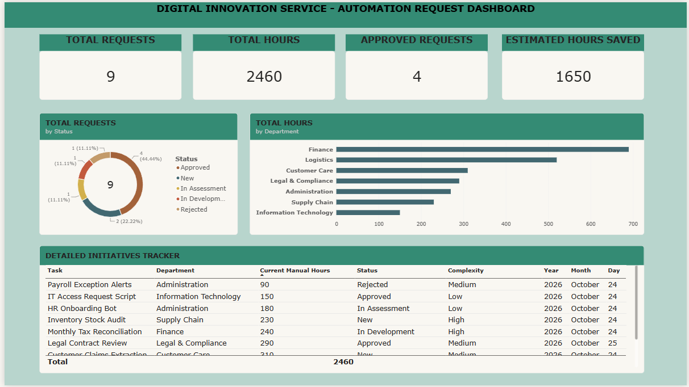
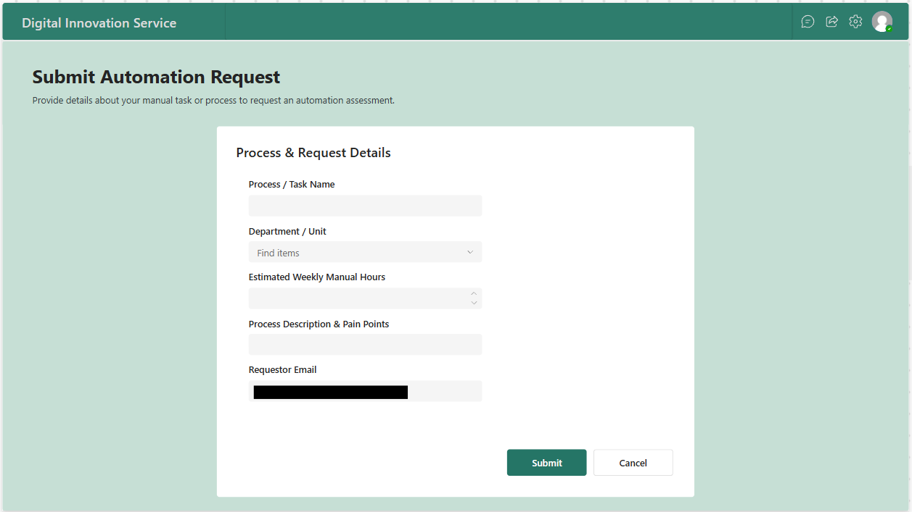
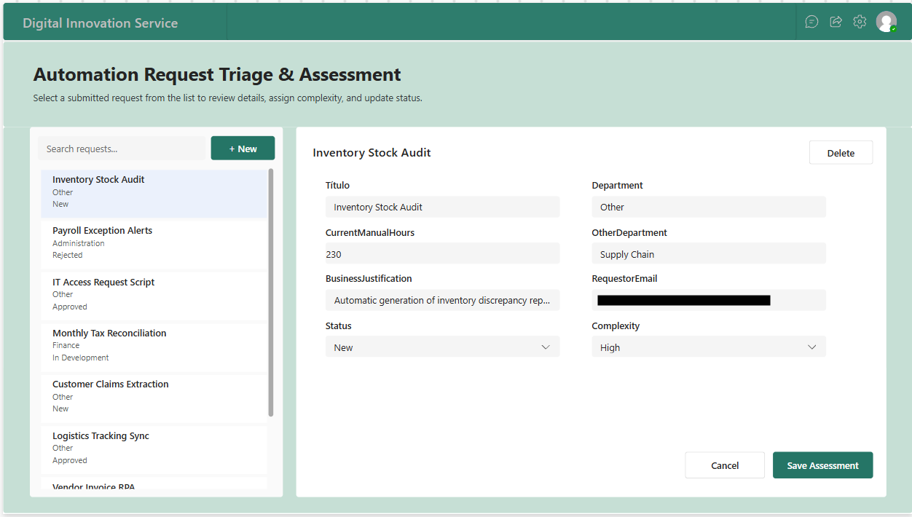
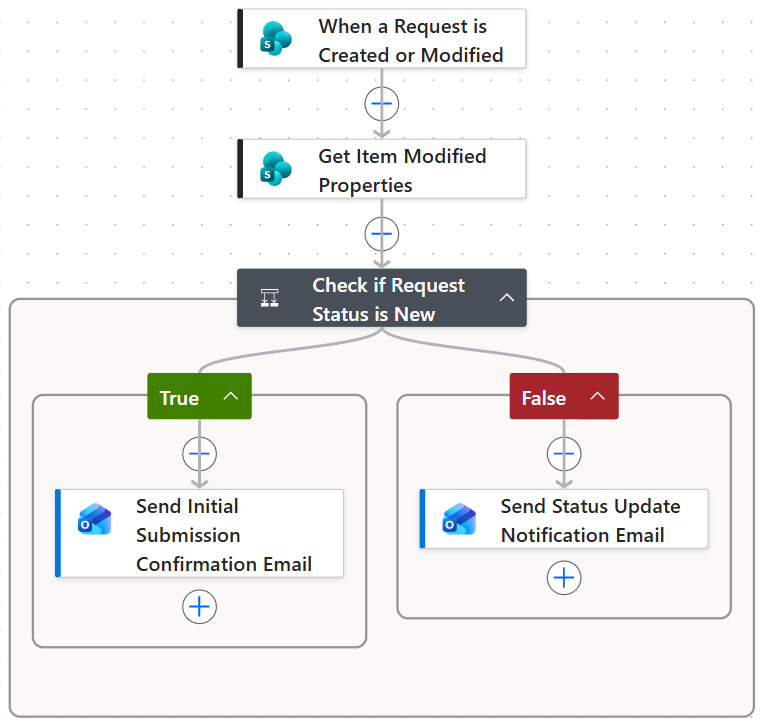
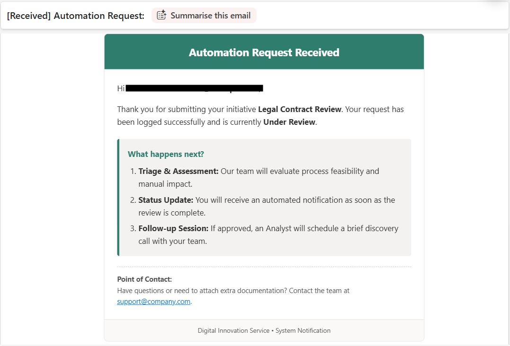
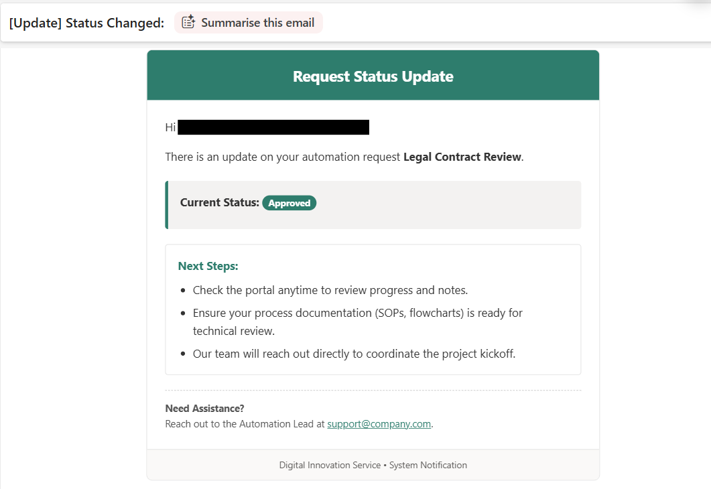

## Business Problem & Solution

### The challenge
Before this portal was implemented, automation requests were managed through informal channels (emails, chat messages, ad hoc meetings), which led to:
* **Lack of record-keeping:** There is no database containing the requests.
* **Poor communication with stakeholders:** a lack of automated visibility into the status of requests for requesters.
* **Lack of tracking:** There was no centralised tracking or standardised approval workflows.

### The Solution
A communication and update channel that standardises the receipt of requests, automates communications relating to their review, and provides useful information for managers. I designed a four-tier architecture:

1. **Power Apps (user interface):** Form for submitting new requests. Includes an administration panel for the automation department to update requests.
2. **SharePoint Online (database):** List containing request details to maintain controlled records.
3. **Power Automate (event-driven trigger):** Automated workflow that sends emails with status updates when a record is created or modified.
4. **Power BI (executive analytics):** Custom DAX measures for monitoring data via a dashboard.

### Business Impact & Key Metrics
* **Total Manual Hours Evaluated:** 2,460 hours/year identified across submitted initiatives.
* **Projected Annual Hours Saved:** 1,650 hours/year in high-value savings unlocked from Approved and In-Development automation projects.
* **100% Communication Automation:** Fully automated status notification pipeline eliminating administrative follow-up overhead.

---

## Executive Analytics (Power BI Dashboard)

The executive dashboard provides immediate visibility into total request volume, potential manual hours saved, approval rates, and department distribution.

### Key Analytics Features:
* **Core Metrics:** Real-time tracking of Total Requests, Total Manual Hours Evaluated, and Projected Annual Hours Saved.
* **Request chart:** Donut chart analyzing request distribution by status (*New*, *In Assessment*, *Approved*, *In Development*, *Rejected*).
* **Department chart:** Clustered bar chart highlighting potential manual hours saved across business units.
* **Table Initiatives Tracker:** Detailed record list.

---

## Automation Flow (Power Apps, Power automate)

Form for submitting an automation request and admin panel. The backend system continuously monitors the data layer to manage approval notifications and stakeholder updates without manual intervention.

### Key Form:
* **Submit Form:** Form for submitting a new automation request.
* **Assessment Panel:** Application management panel.

### Key Flow Actions:
* **Trigger:** Fires when a new request is submitted or updated in SharePoint.
* **Property Evaluation:** Checks whether the `Status` field has changed to trigger targeted communication.

### Key Email:
* **Automated Branding Emails:** Dispatches responsive HTML email templates customized with dynamic request metadata.

## Author
* **Portfolio Project:** automation-request-power-platform
* **Technology Focus:** Power Platform (Power Automate, Power Apps, Sharepoint, Power Bi)
* **Name:** Barbara Contreras

---
> [!NOTE]
> **Data Privacy & Security Disclaimer:**
> To comply with corporate privacy standards and data protection policies, all internal tenant URLs, proprietary schema names, and specific stakeholder email addresses have been masked, or parameterized across codebase scripts and documentation visuals.
